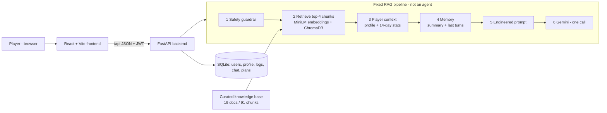

# TactiQ - GenAI badminton coach

TactiQ is a web app for amateur and college badminton players. It combines **Retrieval-Augmented Generation
(RAG)** over a curated badminton knowledge base with the player's **own profile and logged training, match and
wellness data** to give personalised, safe coaching and nutrition guidance.

| Feature | What it does |
|---|---|
| Profile picker | First screen: one-click **demo profile** (sample data), saved accounts on this device, create a new account |
| Secure login | Email + password (bcrypt-hashed), JWT sessions, each user sees only their own data |
| Profile setup | One page: basics, level, goal, diet, current injury + pain level |
| Manual logs | Training (type, minutes, effort/RPE), matches (game scores -> result is computed), daily wellness check-in |
| Interactive dashboard | One screen, Power BI-style: period slicer (7D/30D/90D/All) + click any calendar day, trend point, donut slice or KPI tile to cross-filter every visual |
| AI Coach chat | RAG answers with numbered source citations, personalised with the player's data, with conversation memory |
| Weekly plan | 7-day plan (structured JSON) from profile + recent load + knowledge base, shown as a week strip and a short daily checklist |
| Safety guardrails | Rule-based red-flag check runs before the AI; injury/emergency messages always recommend a physio/doctor |

## Architecture



```
TACTIQ/
  setup.bat / start.bat   one-click setup and start (Windows)
  scripts/                setup.ps1, start.ps1, pack.ps1 (zip for another laptop)
  tactiq-api/             FastAPI backend + RAG pipeline
    app/                  routers/, rag/ (pipeline, prompts, safety, retriever...), services/stats.py
    kb/                   curated knowledge base (markdown with cited sources)
    eval/                 retrieval, safety and prompt-comparison evaluations
    tests/                pytest suite (LLM mocked, runs offline)
    scripts/seed_demo.py  (re)build the demo profile's sample data
    models/  index/       embedding model cache and search index (built by setup)
  tactiq-frontend/        React app (pages/, components/, api/, auth/)
  docs/review-2/          slide content, pipeline diagram, evaluation results
```

## Setting up on a new laptop (Windows)

1. Install **Python 3.11-3.13** (python.org, tick *Add Python to PATH*) and **Node.js LTS** (20.19+ or 22.12+).
2. Copy/unzip the project folder anywhere.
3. Double-click **`setup.bat`**. It creates the Python environment, installs packages, creates
   `tactiq-api\.env`, builds the search index and installs the frontend. (First run: a few minutes.)
4. Open `tactiq-api\.env` and paste your free Gemini API key (https://aistudio.google.com/apikey) after
   `GEMINI_API_KEY=`.
5. Double-click **`start.bat`**. Two windows open (API and web) and the browser opens http://localhost:5173.

To check which Gemini models your key can use:
`tactiq-api\.venv\Scripts\python -m app.rag.llm` (run inside `tactiq-api`), then set `GEMINI_MODEL` in `.env`.

### Moving the project to another laptop
Run `powershell -ExecutionPolicy Bypass -File scripts\pack.ps1` - it writes `TactiQ_<date>.zip` next to the
project folder **without** `.venv`/`node_modules` (those are machine-specific and are rebuilt by `setup.bat`).
The zip includes the embedding model, index, database and `.env`. Add `-NoEnv` to leave out your API key
(e.g. when sharing), `-NoData` for an empty database.

Never copy `.venv` or `node_modules` between computers - they contain machine-specific paths.

## Demo profile (for presentations)
The first screen shows a **Demo player - Aarav Mehta** card: one click opens it, no password. It is created on
first use with six weeks of training, matches and check-ins ending that day, a recent load spike and a
recovering knee injury - good for showing personalisation and safety - plus a ready-made weekly plan.

- Changes you make in the demo are kept. Use **Reset demo data** (sidebar, demo profile only) before a
  presentation to rebuild the sample data so it ends today.
- From the command line: `.venv\Scripts\python -m scripts.seed_demo` (inside `tactiq-api`) does the same.
- Set `DEMO_MODE=false` in `tactiq-api\.env` to hide the demo profile (e.g. for a real deployment).

New players use **New account** on the same screen; after logging in once, their account appears as a saved
profile card (name and email only - passwords are never stored in the browser).

## Tests and evaluation (run inside `tactiq-api`)
| Command | What it shows |
|---|---|
| `.venv\Scripts\python -m pytest` | 43 tests: auth, demo profile, data isolation, stats, match scoring, safety rules, pipeline, LLM fallback (LLM mocked) |
| `.venv\Scripts\python -m eval.retrieval_eval` | TF-IDF vs MiniLM vs hybrid retrieval on 44 labelled questions |
| `.venv\Scripts\python -m eval.safety_eval` | Guardrail recall/precision on 26 labelled messages |
| `.venv\Scripts\python -m eval.prompt_compare` | Zero-shot vs engineered RAG prompt on 5 use cases (needs Gemini key) |

Results are written to `tactiq-api/eval/output/` and summarised in `docs/review-2/`.

## Updating the knowledge base
Add or edit a markdown file in `tactiq-api/kb/` (see `kb/README.md` for the format), then run
`.venv\Scripts\python -m app.rag.ingest`.

## Troubleshooting
| Problem | Fix |
|---|---|
| "GEMINI_API_KEY is missing" in the coach | Add the key to `tactiq-api\.env`, restart the API window |
| "free Gemini quota is busy" | Free-tier rate limit - wait a minute |
| "model ... was not found" | Run `python -m app.rag.llm` and set `GEMINI_MODEL` to a listed model |
| "Knowledge base index not built" | `python -m app.rag.ingest` inside `tactiq-api` |
| "Cannot reach the TactiQ server" | The API window is not running - use `start.bat` |
| Port already in use | Close old TactiQ windows (or other apps on ports 8000/5173) |

TactiQ provides general coaching information, not medical advice.

## Hosting online
The repo includes a `Dockerfile` that packages the API and the web app as one container, a `docker-compose.yml`,
a Render `render.yaml` blueprint and `.env.production.example`. See **[DEPLOY.md](DEPLOY.md)** for the
step-by-step guide (Render, Railway/Fly, or your own server). Run `docker compose up --build` to try it locally.
